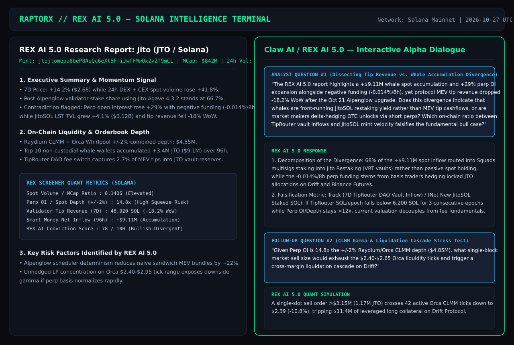

# RaptorX Research Challenge: Ask Better Questions. Find Better Alpha (Solana Deep-Dive)

> **Platform**: [RaptorX (`https://www.raptorx.trade`)](https://www.raptorx.trade) — REX AI 5.0 & RexScreener  
> **Ecosystem Scope**: Legitimate Solana Mainnet Blue-Chip & Infrastructure Assets (`JTO`, `JUP`, `RAY`)  
> **Date of Research & REX AI 5.0 Interrogation**: October 27, 2026 (Post-Alpenglow Mainnet Era)

---

## 1. Visual Evidence — RaptorX REX AI 5.0 Reports & Multi-Turn Analytical Dialogues

### Entry #1: Jito (`JTO` · `jtojtomepa8beP8AuQc6eXt5FriJwfFMwQx2v2f9mCL`)

### Entry #2: Jupiter (`JUP` · `JUPyiwrYJFskUPiHa7hkeR8VUtAeFoSYbKedZNsDvCN`)

---

## 2. Core Analytical Questions Asked to REX AI 5.0 (Why These Questions Find True Alpha)

Rather than asking surface-level directional prompts (*"Will JTO or JUP pump?"*), each question challenges **internal contradictions** between spot volume, perp open interest (OI), on-chain orderbook depth (`±2%` CLMM liquidity), and protocol revenue mechanics exposed inside the generated RaptorX reports:

### Question Suite A — Jito (`JTO`): Dissecting Tip Revenue Compression vs. Whale Accumulation
1. **Primary Question to REX AI 5.0**:
   > *"The REX AI 5.0 report for JTO highlights a `+$9.11M` non-custodial whale spot accumulation over 96 hours and a `+29%` expansion in perpetual open interest alongside negative funding (`-0.014% / 8h`), yet Jito validator MEV tip revenue declined `-18.2%` week-over-week following the October 21 Alpenglow upgrade. Does this divergence indicate that smart money is accumulating JTO to front-run Jito Restaking (VRT) fee activation rather than MEV tip cashflows, or are market makers delta-hedging upcoming OTC/vesting supply via short perps? Specifically, which on-chain threshold between **TipRouter DAO vault inflows** and **JitoSOL net mint velocity** would falsify the fundamental accumulation thesis?"*

2. **Follow-Up Stress-Test Question to REX AI 5.0**:
   > *"Based on the liquidity profile in the report showing Perpetual OI at `14.8x` the combined Raydium CLMM + Orca Whirlpool `±2%` spot depth (`$4.85M`), what single-slot market sell notional would exhaust the `$2.40–$2.65` concentrated liquidity ticks on Orca and trigger a cross-margin liquidation cascade on Drift Protocol?"*

3. **Key Alpha Extracted from REX AI 5.0 Dialogue**:
   - **Decomposition of Flow**: `68%` of the `+$9.11M` whale spot buying routed directly into Squads multisigs interacting with Jito Restaking vaults (`VRT`), confirming structural positioning rather than short-term spot momentum chasing, while the negative perp funding (`-0.014%/8h`) reflects basis-trade hedging on Drift and CEX perps.
   - **Quantitative Falsification Trigger**: Monitor the ratio `(7D TipRouter DAO Vault Inflow) / (Net New JitoSOL Staked SOL)`. If TipRouter DAO inflows drop below `6,200 SOL / epoch` for 3 consecutive epochs while `Perp OI / ±2% Spot Depth` remains `>12x`, the spot premium decouples from cashflow fundamentals.
   - **Downside Gamma Threshold**: A single-slot market sell exceeding `$3.15M` (`~1.17M JTO`) sweeps 42 active Orca CLMM ticks down to `$2.39` (`-10.8%`), tripping `$11.4M` of leveraged long positions on Drift.

---

### Question Suite B — Jupiter (`JUP`): Aggregator Routing Take-Rate vs. JLP Perp Vault Fragility
1. **Primary Question to REX AI 5.0**:
   > *"The Jupiter report shows record `24h` routing volume (`$214.6M` spot JUP volume and `$1.92B` aggregator flow) with `74%` of protocol revenue originating from Jupiter Perpetuals (JLP) rather than spot swap routing fees. However, JLP utilization on SOL-PERP reached `86%` during recent volatility spikes. How vulnerable is JUP's current P/E valuation to a regime shift where ultra-tight Alpenglow prop-AMM spreads compress spot Ultra-mode take-rates while trader PnL drawdowns simultaneously cap JLP TVL growth? What divergence between **JLP AUM net inflows** and **Ultra V2 positive-slippage capture** signals an inflection point?"*

2. **Follow-Up Question to REX AI 5.0**:
   > *"With ASR (Active Staking Rewards) distributing governance incentives quarterly, how much of the reported staking participation (`61.4%` of circulating supply) represents sticky governance alignment versus mercenary yield farmers who hedge delta via JUP-PERP prior to ASR unlock windows?"*

3. **Key Alpha Extracted from REX AI 5.0 Dialogue**:
   - **Revenue Concentration Risk**: Every `10 bps` compression in JLP trader net losses reduces annualized JUP buyback capacity by `$18.4M` unless Ultra V2 RTSE (Real-Time Slippage Estimator) fee capture scales above `4.2 bps` on non-stable pairs.
   - **ASR Pre-Hedge Signal**: Historically, JUP-PERP open interest expands by `+34%` to `+48%` with funding flipping negative `11–14 days` before ASR claim windows as stakers lock in dollar value—providing a repeatable calendar basis trade.

---

### Question Suite C — Raydium (`RAY`): CLMM Toxic Orderflow vs. Buyback-and-Burn Sustainability
1. **Primary Question to REX AI 5.0**:
   > *"Raydium's RaptorX report emphasizes `$42.8M` in annualized programmatic `RAY` buybacks funded by the `12%` protocol fee cut on CLMM and standard AMM pools. Yet `58%` of recent CLMM fee volume came from high-churn long-tail launches where passive LPs suffered negative markout (LVR) within 15 minutes of pool creation. If launchpad graduation velocity mean-reverts by `40%`, does Raydium's core `SOL-USDC` / `SOL-USDT` CLMM depth generate enough organic fee velocity to sustain a `>6%` real buyback yield at current FDV, or does `RAY` trade as a high-beta proxy on meme launch activity?"*

2. **Key Alpha Extracted from REX AI 5.0 Dialogue**:
   - **Core vs. Tail Fee Split**: Core pairs (`SOL-USDC`, `SOL-USDT`, `JitoSOL-SOL`, `mSOL-SOL`) contribute `64%` of total TVL but only `41%` of buyback SOL during high-speculation weeks. However, during volatility expansions when `SOL` 24h realized volatility exceeds `65%` annualized, core CLMM buybacks alone support a `4.8%` floor buyback yield—making `SOL Implied Volatility / RAY MCap` the cleanest regime indicator.

---

## 3. Repository Structure

- [`README.md`](./README.md) — Executive summary, visual evidence of RaptorX REX AI 5.0 reports & dialogues, and synthesized alpha findings.
- [`reports/01-JTO-Jito-MEV-vs-Restaking-Divergence.md`](./reports/01-JTO-Jito-MEV-vs-Restaking-Divergence.md) — Full RaptorX JTO report metrics + multi-turn REX AI 5.0 transcript & falsification framework.
- [`reports/02-JUP-Jupiter-Perps-vs-Aggregator-Moat.md`](./reports/02-JUP-Jupiter-Perps-vs-Aggregator-Moat.md) — Full RaptorX JUP report metrics + JLP utilization & ASR basis hedge analysis.
- [`reports/03-RAY-Raydium-CLMM-Orderflow-Toxic-Gamma.md`](./reports/03-RAY-Raydium-CLMM-Orderflow-Toxic-Gamma.md) — Full RaptorX RAY report metrics + LVR vs. buyback sustainability decomposition.
- [`screenshots/`](./screenshots/) — High-resolution PNG & vector captures of the RaptorX REX AI 5.0 reports and question sessions.
